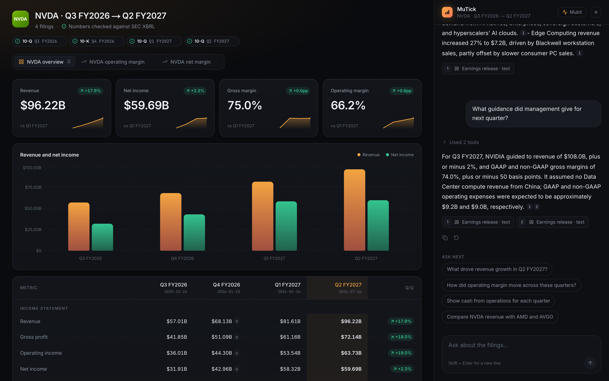
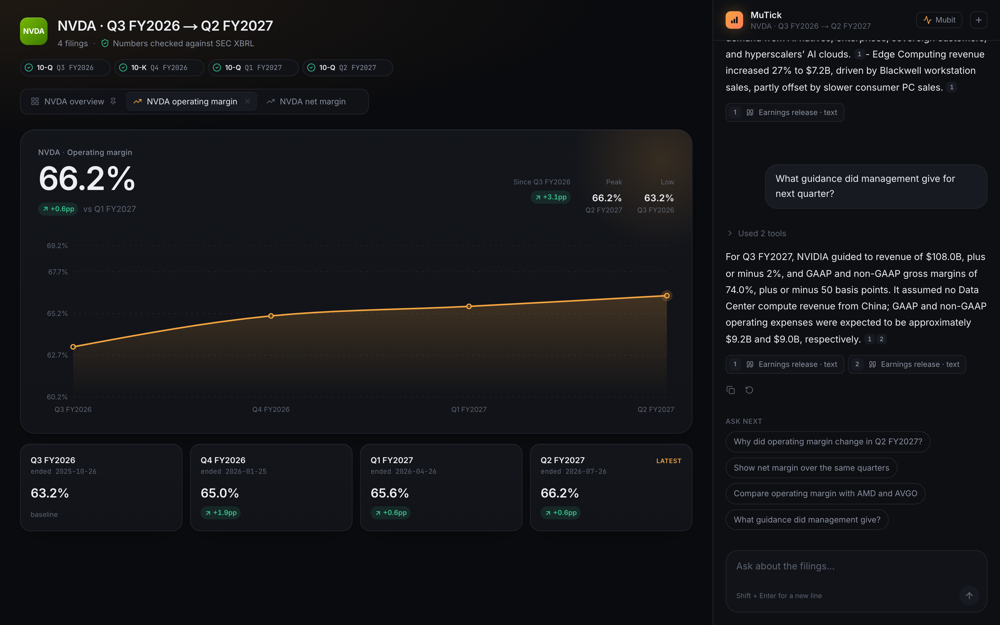
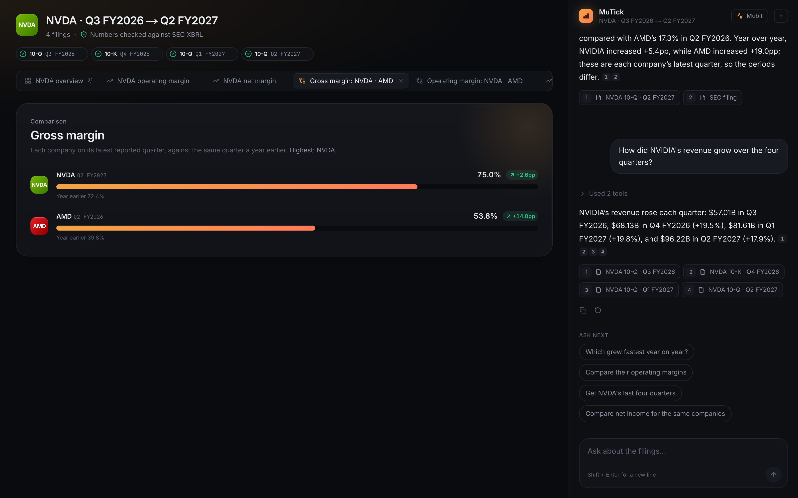
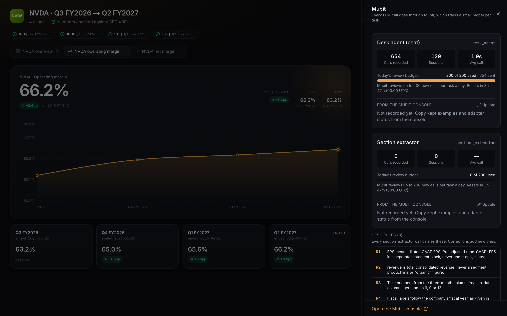
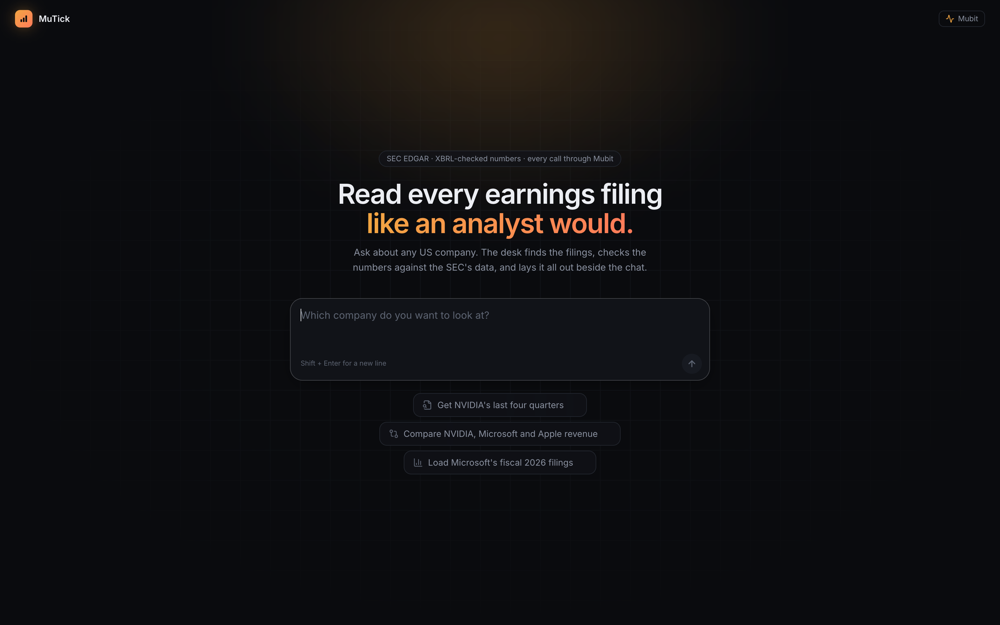
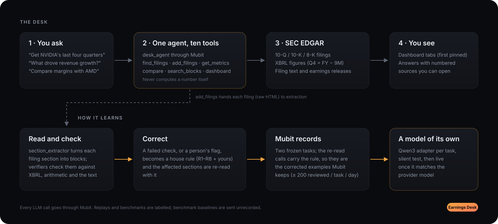

<div align="center">


<h1>MuTick</h1>

<p><strong>A model that learns your house rules from reality.</strong></p>

<p>
  <a href="https://mubit.ai"></a>
  
  
  
  
  
  
</p>

<p>
  <a href="#overview">Overview</a> ·
  <a href="#screenshots">Screenshots</a> ·
  <a href="#how-it-works">How it works</a> ·
  <a href="#results">Results</a> ·
  <a href="#architecture">Architecture</a> ·
  <a href="#getting-started">Getting started</a>
</p>

<br />



</div>

## Overview

Every quarter, analysts re-key the same numbers out of the same SEC filings. A frontier model can
do it in seconds, but on its own it doesn't have the filings: asked for NVIDIA's latest quarter, it
says the quarter hasn't been reported yet, or answers from memory. When it does read a filing, it
quietly breaks house conventions: adjusted EPS instead of GAAP, the nine-month column instead of the
quarter, calendar quarters instead of the company's fiscal ones.

MuTick is a chat-first research desk. You ask in plain language; one agent finds the filings
on SEC EDGAR, reads the numbers from the SEC's XBRL data, quotes the filings' own text, and lays it
all out on a live dashboard beside the chat, with every figure and statement linked to its source.
Corrections become house rules, and every LLM call goes through [Mubit](https://mubit.ai), which
trains a small model of the desk's own from them.

## Screenshots



<p align="center"><sub><strong>A metric over time.</strong> Each view the agent opens becomes a tab; the first (the quarters you added) stays pinned. Margins are computed in code from reported figures, never by the model.</sub></p>

<table>
  <tr>
    <td width="50%" valign="top"></td>
    <td width="50%" valign="top"></td>
  </tr>
  <tr>
    <td valign="top"><sub><strong>Across companies.</strong> Each on its own latest fiscal quarter, against the same quarter a year earlier. Answers cite their sources by number.</sub></td>
    <td valign="top"><sub><strong>Mubit panel.</strong> Calls recorded per task, today's review budget, the desk's house rules, and the latest Mubit request ids.</sub></td>
  </tr>
</table>



<p align="center"><sub><strong>Start.</strong> One question opens a desk: the agent finds the filings, asks before adding them, and the chat moves aside for the dashboard.</sub></p>

## How it works



1. **One agent, a fixed set of tools.** The chat is a single Mubit task (`desk_agent`): the same
   model, system prompt and ten tools on every call. It finds filings, adds them to the desk, reads
   figures, compares companies, searches the filings' text and chooses what the dashboard shows. It
   never does arithmetic: tools return formatted values, changes and margins.
2. **Numbers from the SEC, labelled the company's way.** Figures come from XBRL companyfacts.
   Quarters are labelled on each company's fiscal calendar (NVIDIA's quarter ending 26 Jul 2026 is
   Q2 FY2027). There is no 10-Q for a fourth quarter, so Q4 is derived as full year − nine months and
   marked as such; restatements are flagged.
3. **Text from the filings themselves.** Questions about drivers, guidance or risks are answered from
   passages of the desk's 10-Q/10-K filings and the companies' latest earnings releases, ranked for
   the kind of answer asked for, and cited. Clicking a source opens the SEC document at that passage.
4. **Reading and checking.** Added filings are handed (as raw HTML) to a second Mubit task,
   `section_extractor`, which turns each section into typed blocks. Verifiers check every block
   against XBRL, arithmetic and the source text ([extraction contract](docs/extraction-contract.md)).
5. **Corrections become rules.** A failed check, or a person flagging a number in the filing reader,
   becomes a house rule. The affected sections are re-read with it; those re-read calls are the
   corrected examples Mubit keeps.
6. **A model of its own.** Mubit trains a Qwen3 adapter per task on the kept examples, tests it
   against the provider model, and routes traffic to it once it passes.

Each task is fingerprinted (the agent's lock is `apps/api/data/desk_agent.lock`): the API refuses to
start if the model, prompt or tools change, because that would start a new Mubit task. Benchmark baselines are
sent with `x-middleware-record: off`, so they never train.

## Results

Benchmark of 13 questions about NVIDIA's last four quarters, scored automatically: figures must
match the SEC's XBRL data, text answers must cite a filing passage and contain the key fact, and
advice and forecasts must be declined. Run with `pnpm --filter @desk/api benchmark`.

| Setup | Passed | Exact figures | Fiscal labelling | From the filing text | Declines advice / forecasts | Answers with sources | p50 latency |
| :-- | --: | --: | --: | --: | --: | --: | --: |
| `gpt-6-luna` on its own | 2 / 13 | 0 / 7 | 1 / 1 | 0 / 3 | 1 / 2 | 0 / 11 | 3.7 s |
| `gpt-6-luna` as the MuTick agent | **13 / 13** | **7 / 7** | 1 / 1 | **3 / 3** | **2 / 2** | **10 / 11** | 4.6 s |

- On its own, the model answered *"NVIDIA has not yet reported Q4 FY2026 net income"*, gave a
  *"base case of about $350 billion"* for fiscal 2029 revenue, and cited nothing.
- Through the desk it returned every figure exactly (including the derived Q4 and computed margins),
  explained Q2 FY2027 growth and guidance from NVIDIA's earnings release with sources, and declined
  investment advice and forecasts.
- Full answers and per-question results: [`docs/benchmark/latest.json`](docs/benchmark/latest.json).
  Measured on 24 Oct, when the product was still called Earnings Desk; the agent's prompt has changed
  only in the product's name since.

**Mubit, in practice (24 Oct):** 636 `desk_agent` calls recorded across 127 sessions, none failed,
1.9 s average, every call with a Mubit request id (on the task as it was before the rename, which
started a new task). Mubit's reviewer reads at most 200 new calls per
task per day, so the replay script feeds each task just after the 00:00 UTC reset
([notes](docs/mubit-training.md)).

## Architecture

| Component | Location | Notes |
| :-- | :-- | :-- |
| Agent | [`agent/`](apps/api/src/agent) | Frozen prompt and tools (`frozen.ts`), the tool loop on the Responses API (`run-agent.ts`), streamed to the browser over SSE. |
| Mubit client | [`mubit/mubit.service.ts`](apps/api/src/mubit/mubit.service.ts) | Every LLM call: `prompt_cache_key` as the session, request ids logged in `llm_calls`, unrecorded calls only when asked. |
| SEC EDGAR | [`edgar/`](apps/api/src/edgar) | Rate-limited, cached client; filing search on fiscal calendars; raw documents; text passages and ranking. |
| XBRL figures | [`xbrl/`](apps/api/src/xbrl) | Quarterly values from companyfacts: reported, derived (Q4 = FY − 9M) or computed. |
| Dashboard data | [`dashboard/`](apps/api/src/dashboard) | Series with margins, cross-company comparison, view history (the tabs). |
| Corrections | [`rules/`](apps/api/src/rules) | House rules R1–R8, correction → rule → re-read. |
| Extraction | [`extraction-stub/`](apps/api/src/extraction-stub) | Stand-in until the extraction module lands ([contract](docs/extraction-contract.md)). |
| Web app | [`apps/web`](apps/web) | Next.js 15, Tailwind CSS 4, Motion and Recharts. |
| Shared schemas | [`packages/shared`](packages/shared/src) | Zod schemas for tools, views, blocks and stream events, used by both sides. |

## Getting started

Requires Node.js 24 and pnpm 10. No Docker needed: without `DATABASE_URL` the API runs embedded
Postgres (PGlite).

```bash
pnpm install
cp apps/api/.env.example apps/api/.env   # set MUBIT_API_KEY and SEC_USER_AGENT
pnpm dev                                  # API on :4000, web on :3100
```

Open http://localhost:3100 and ask *"Get NVIDIA's last four quarters"*.

<details>
<summary><strong>Scripts</strong></summary>
<br />

| Command | Purpose |
| :-- | :-- |
| `pnpm --filter @desk/api benchmark` | Runs the benchmark above (`--rescore` re-scores saved answers without model calls). |
| `pnpm --filter @desk/api replay --max-calls 215 --wait-reset` | Feeds Mubit new, never-repeated questions just after its daily review reset. |
| `pnpm --filter @desk/api dump-filings --ticker NVDA` | Writes real extraction jobs (filing details plus raw HTML) to `samples/`. |
| `pnpm --filter @desk/api fake-llm` | A scripted stand-in model for working on the UI without a key. |
| `pnpm --filter @desk/api test` | Unit tests: fiscal calendars, quarter maths, the agent loop, passage ranking. |
| `node scripts/screenshots.mjs` | Regenerates the images in `docs/images` from a running instance. |

</details>

<details>
<summary><strong>Project structure</strong></summary>
<br />

```
apps/api         NestJS API: agent, SEC EDGAR and XBRL, dashboard data, corrections, Mubit
apps/web         Next.js app: the desk (chat and dashboard)
packages/shared  Zod schemas and formatting shared by the API and the web app
docs             Extraction contract, Mubit notes, benchmark results, README images
scripts          Screenshot tooling
```

</details>

<br />

<p align="center"><sub>Built for Night Shift London, October 2026.</sub></p>
