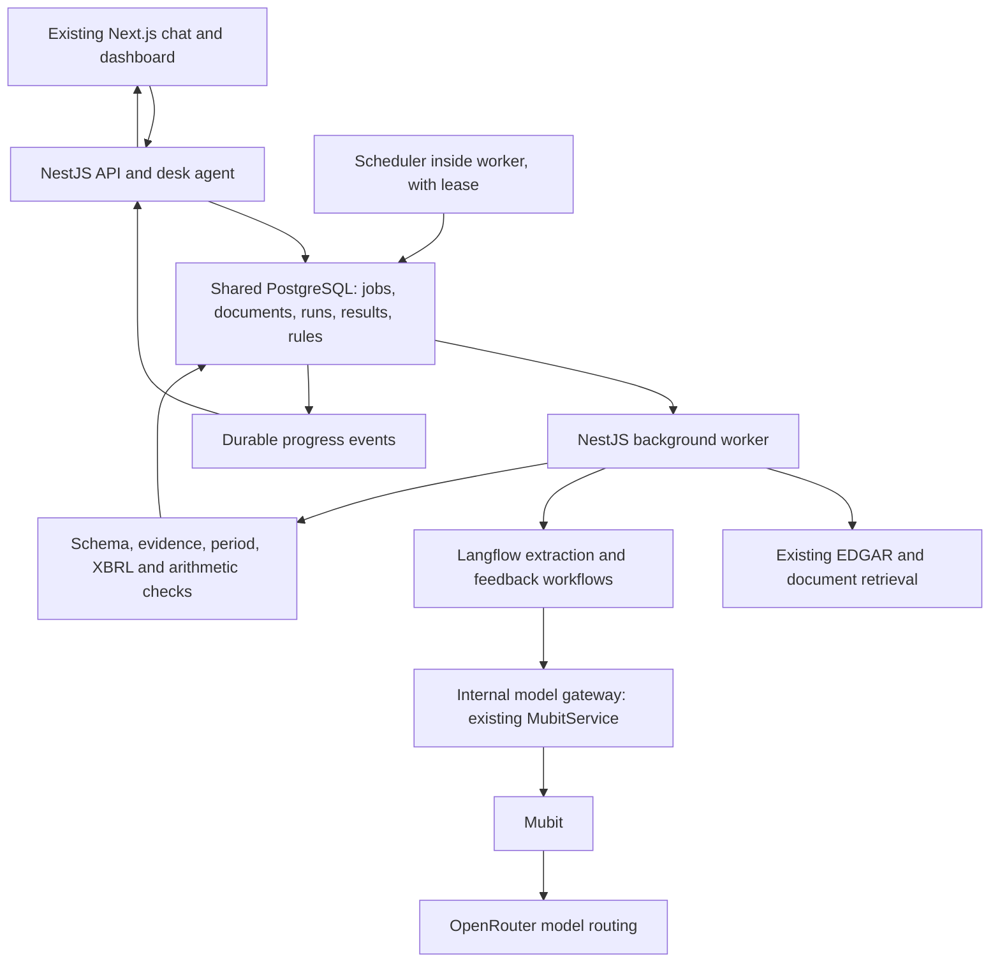

# Earnings Desk — Integrated Extraction Implementation Plan

Status: design implemented as a local integrated version, based on repository commit `a0475cc`. See [implementation status](implementation-status.md) for tested paths and remaining live acceptance work. This replaces the standalone Python-service design. The implemented [v2 contract](extraction-contract-v2.md) documents details where storage and delivery choices differ from the original plan.

## 1. Architecture decision

Extend the existing TypeScript/NestJS backend and shared PostgreSQL database. Reuse the Next.js client, desk agent, EDGAR retrieval, XBRL services, Zod types, and Drizzle migrations. Run API and background work as separate processes built from the same backend image. Langflow runs section-extraction and feedback workflows; the existing desk agent remains the conversational planner.

The [current extraction contract](extraction-contract.md) is the starting integration surface. Changes proposed here must be implemented together with the affected shared types, callers, database queries, and client views. This document does not silently change the current contract or its frozen Mubit tasks.



The gateway is an internal model-call facility within the existing backend, not a separate extraction service or a compatibility adapter. Business logic, jobs, and database writes remain in NestJS. Langflow receives bounded workflow inputs and returns typed outputs.

## 2. Confirmed product requirements

- One internal team initially; retain team IDs and enforce access through server-resolved identity. Multiple-team onboarding is deferred.
- SEC EDGAR monitoring, initially AAPL, MSFT, NVDA, WMT, and JPM. Backfill the last four reported fiscal quarters per company, then discover new filings within approximately 15 minutes under normal conditions.
- Natural-language extraction requests support additional companies and fields. A new resolved company is added to ongoing monitoring and receives the standard backfill.
- Uploads automatically start default-schema extraction. Start with HTML, text, and text-based PDF; scanned-document OCR remains a later extension.
- Default facts: revenue, net income, GAAP diluted EPS, fiscal period, units, and evidence. Additional requested facts include guidance and other source-supported metrics.
- Starter rules: quarterly GAAP values; preserve printed values/currency/scale; also normalize USD totals to millions; keep EPS in currency per share; no implicit FX conversion; unsupported facts remain missing with a reason.
- The system evaluates feedback and updates the relevant agent policies/examples and house rules automatically. Learned changes apply to the same team and, where relevant, a specific company.
- Accepted rule changes automatically reprocess affected records in each company's last four reported quarters, preserving revisions and progress.
- Run locally with Docker Compose and Langflow first. Production hosting follows later.
- Benchmark direct OpenRouter versus Mubit → OpenRouter calls for latency, accuracy, and cost using the [test plan](test-and-benchmark-plan.md) and [report](benchmark-report.md).

## 3. Ownership within the existing backend

| Module | Responsibility |
| --- | --- |
| `agent/` | Existing desk agent interprets chat and extraction intent; submits typed requests through tools; consumes results and scoped lessons |
| `edgar/` | Single owner of SEC requests, company resolution, discovery, rate limits, cache, and downloads |
| `documents/` | General document registry, raw-file storage, uploads, text/table preparation, and source locations; reuse/move the existing SEC document loader where appropriate |
| `extraction/` | Submission, run orchestration, section selection, validation, persistence, and result selection; replaces the stub |
| `jobs/` | Durable queue, worker leases/heartbeats, retries, scheduler leadership, and progress outbox |
| `feedback/` | Evaluate corrections, trace their causes, test changes, and schedule reprocessing |
| `rules/` | Immutable team/company-scoped rule and policy versions, active bundles, and rollback history |
| `workflows/` | Langflow client, typed workflow inputs/outputs, and workflow revision tracking |
| `mubit/` | Chat Completions transport through Mubit/OpenRouter, versioned task contracts, credentials, request IDs, and attempt telemetry |
| `xbrl/`, `dashboard/` | Existing reference facts, deterministic calculations, and views; make source/method/conflict information explicit |

Do not add a second conversational planner. Requests to the extraction HTTP endpoint reuse the desk agent's intent-planning capability with an extraction-specific tool policy; chat and HTTP ultimately call the same submission service. Scheduled ingestion and uploads submit a deterministic default specification without an unnecessary planning call.

## 4. Four extraction API operations

These live in the existing NestJS application. Existing chat, filing, project, and dashboard routes remain available; four operations describe the extraction capability, not the total route count of the desk.

| Operation | Proposed route | Behavior |
| --- | --- | --- |
| Get data | `GET /v1/data` | Query request/run/document/result/feedback IDs or company-period filters; return state, facts, blocks, evidence, revisions, and reprocessing progress |
| Upload | `POST /v1/files` | Multipart upload; return `201` with document ID, automatically queued extraction ID, and polling location |
| Feedback | `POST /v1/feedback` | Feedback text plus target result/run and optional correction/evidence; return `202` and feedback ID |
| Request extraction | `POST /v1/extractions` | Natural-language request plus optional document/project/conversation context; return `202` and request ID |

Unresolved company/period ambiguity becomes `needs_clarification`; return a question through GET and accept the answer via the extraction POST with a parent request reference. Do not add guessed companies to the watchlist. Resolve relative dates once and retain the interpreted plan.

Support idempotency keys for upload, extraction, and feedback. Pin the schema, workflow, source checksum, and rule/policy bundle for each run. A retry reuses the same run; a changed rule/specification can create a new revision. Existing `filings.status = ready` from the stub is not proof of completed extraction: reuse requires a real completed run with persisted outputs.

## 5. Contract changes to implement together

| Current contract | Integrated change |
| --- | --- |
| Filing metadata plus raw HTML only | Add a request envelope, generalized document references, requested fields, run ID, team/project context, and version bundle |
| `extractFiling(job)` resolves only when complete | Introduce durable `submitExtraction(...)` returning a receipt; update `add_filings` to enqueue and return immediately. Keep any finish-summary helper internal to the worker |
| One filing belongs to one project | Introduce project-document/filing membership so adding a filing to a new desk does not move it out of another |
| Accession is the only source identity | Use document/source IDs; keep SEC accession when available. Do not fabricate SEC identifiers for uploads |
| Section/block IDs contain only accession and ordinal | Include document and immutable run/revision identity; keep legacy IDs readable so old citations remain valid |
| Filing release date and reporting period share `periodEnd` for 8-Ks | Separate filing/publication date from fiscal period start/end; validate extracted period against the source's reporting context |
| Headline metric keys and a scalar block value | Retain legacy keys such as `eps_diluted`; add a fact envelope for extra metrics, basis, currency, ranges/qualifiers, missing reasons, normalized values, and derivations |
| Global active rules | Add team/company/metric scope, immutable versions, applicability, supporting feedback, and activation history |
| Process-local events | Add persistent project/run events and reconnectable delivery across API and worker processes |
| Finished filing never reruns | Cache by source/specification/version identity; rerun affected records after accepted updates |

Preserve the existing six display block types and citation/quote behavior wherever possible. Put general facts in a related `extracted_facts` representation rather than making every additional metric a breaking dashboard change. Preserve printed scale in blocks; derive normalized views in code.

Version any changed model input/output schema explicitly. Changes to desk tools, system instructions, or output schemas require a deliberate new task fingerprint and recorded migration. Keep previous fingerprints and run history; do not simply delete locks to make development changes pass.

### Numerical and verification semantics

- Extractors report what each section says, including annual or year-to-date figures with their true duration. The requested quarterly view is assembled separately; never relabel an annual number as quarterly.
- Keep existing XBRL metrics as a distinct source. Reconcile only like-for-like company, period, basis, currency, and scale. An XBRL value must not silently overwrite the LLM output before benchmarking.
- Preserve quotes exactly and define offsets as JavaScript UTF-16 code units for the current client. Handle repeated quotes deterministically and retain document/page/table context; do not assume Python and JavaScript string offsets are interchangeable.
- Record verifier outcomes as pass, fail, or not-applicable/unknown with reasons. Missing XBRL or unsupported arithmetic is not evidence of a pass. Require source support before a block becomes verified.
- Period checks must allow correctly labeled 3/6/9/12-month observations and comparative periods. The current blanket quarterly check needs revision for year-to-date tables and release-date metadata.
- Keep deterministic derived metrics separate with formulas and inputs. Do not derive quarterly EPS by subtracting cumulative EPS in the strict core result; expose existing approximate XBRL EPS separately until the display policy is reconciled.
- Use source-precision-aware validation; explicitly document any looser operational XBRL tolerances. They are not the benchmark's ground-truth scoring thresholds.

## 6. Data, queue, and progress design

Use additive Drizzle migrations with one migration runner before API/worker startup. The default integrated Docker environment uses real PostgreSQL. Retain PGlite only for isolated single-process development/tests; API and worker must not share one embedded-data directory as if it were a server database.

| Add or extend | Purpose |
| --- | --- |
| Teams and project memberships | Seed the internal team; preserve project ownership and query scope |
| Watchlist memberships and ingestion checkpoints | Persistent monitoring, source freshness, deduplication, backfill state |
| Documents and source versions | SEC/upload metadata, original bytes/checksums, provenance, preparation versions |
| Extraction requests, jobs, attempts, runs | Durable execution, resolved intent, pinned versions, retries, parent/child progress |
| Sections, blocks, extracted facts, checks | Immutable source-linked revisions plus explicit current accepted selection |
| Feedback decisions, rule/policy versions | Traceable evaluation, scope, activation, rollback |
| Reprocessing batches and durable events | Reliable historical reruns and client progress after disconnect/restart |
| Extended LLM call/attempt records | Route, task, request IDs, versions, timestamps, usage categories, errors, and billing reconciliation |

Lease jobs atomically, heartbeat while processing, retry transient failures with bounds, and recover expired leases. Keep one scheduler leader per scope; apply a shared SEC request limiter across API/worker paths. Separate discovery from download completion so checkpoints cannot lose failed downloads. Adjust the current six-hour submissions cache to support the discovery target and reconcile a lookback window after downtime.

Persist result/status changes and outbox events in the same transaction. The API consumes persisted events and sends project-scoped progress; optional PostgreSQL notifications can wake it but are not the durable source. Add a background SSE mode to GET data or a dedicated operational stream, with event IDs/cursors and resume support. Chat-turn streaming remains unchanged. Browser state reloads from persistent data after reconnect; the current in-memory `EventsService` alone is insufficient across processes.

Run state is separate from legacy filing/block state. New runs use queued/running/completed/needs-clarification/needs-review/failed. Continue publishing the client's compatible filing and block status projection while shared event types are expanded. Upload progress uses document IDs; SEC-only event assumptions must be removed in the client.

## 7. Langflow and Mubit integration

Start with two checked-in flows: section extraction and feedback evaluation. NestJS selects/prepares sections, dispatches flow calls with bounded concurrency, checks results, and stores them. Langflow sequences agent calls and transformations; it does not own SEC credentials or application database writes.

To reuse `MubitService.respond`, provide a narrowly scoped, authenticated internal model-call route. Langflow sends task identity, permitted user input, and execution IDs; NestJS assembles the frozen model/prompt/schema and calls Mubit. Keep the route on the internal network, bind calls to an active job, and enforce task/size/call limits. Return structured output and Mubit request identity. No provider keys or unrestricted model proxy are exposed to the client.

Keep general planner/extractor instructions fixed. Supply changing company, requested fields, scoped rules, and accepted examples as explicit runtime context. Add the same applicable lessons to the existing desk agent's input so feedback can influence both stages without casually changing its frozen system prompt. A feedback evaluator has a separate explicit task/logging policy; it is not mislabeled as a section extractor.

The implementation uses Chat Completions on Mubit's OpenRouter compatibility endpoint, with hashed `session_id`, strict schemas, and explicit attempts. The desk loop keeps its internal Responses-shaped interface through a tested transport conversion. A local fake-model HTTP smoke verifies restart and delivery; real provider schemas, recording/exclusion controls, and Langflow execution still require live checks. See [OpenRouter notes](openrouter.md).

Mubit documentation and `docs/mubit-training.md` describe different levels of evidence: public interface documentation versus repository-reported workspace observations. Treat reported daily limits, silent testing, and promotions as workspace observations to verify before planning training. Never claim that a corrected retry guarantees a trained adapter or production promotion. Production calls can be recorded for learning; held-out benchmark calls must use verified exclusion controls and separate evaluation context.

## 8. Feedback and historical updates

The contract's verifier-triggered single retry becomes the local repair loop. Store the first attempt and retry separately, never insert the expected benchmark/XBRL answer into the model input, and include both calls in cost/latency. A temporary repair hint does not automatically become a globally active learned rule.

User feedback and proposed reusable lessons enter the system evaluator. It determines whether the issue belongs to planning, section extraction, or a reporting rule; checks evidence and existing policy; tests the candidate on development examples; then applies, defers, or rejects it with reasons. No routine manual approval step is introduced. Learned rules remain team/company scoped.

Activation publishes an immutable bundle and creates the affected four-quarter reprocessing batch transactionally. Queue each source/target-version combination once. Keep fresh filings responsive while historical work runs. Existing accepted results remain visible until a validated revision is ready; unresolved revisions expose a conflict instead of silently changing the current answer. Late jobs cannot overwrite newer accepted versions. Rule application and reprocessing completion have separate statuses, and reruns do not feed themselves back as new user feedback.

## 9. Repository and Docker layout

```text
apps/
  api/
    Dockerfile
    src/
      main.ts                    # HTTP entry point
      worker.ts                  # Background entry point
      agent/ edgar/ xbrl/         # Extend existing modules
      extraction/ documents/     # New extraction capability
      jobs/ feedback/ rules/     # Durable execution and learning
      workflows/ mubit/          # Langflow and shared inference
      db/ dashboard/ projects/   # Extend existing storage/read paths
    drizzle/                     # Additive migrations
  web/
    Dockerfile                   # Existing client with progress/feedback/upload UI
packages/shared/src/             # Versioned Zod contracts and events
workflows/langflow/
  flows/ components/             # Exported flows and gateway client component
benchmarks/                      # Shared runner, fixtures, labels, reports
compose.yml                      # Extend the existing file
```

Compose services: `web`, `api`, `worker`, `langflow`, and `postgres`, with a one-shot `migrate` service and optional `benchmark` profile. API and worker share one backend image with different commands. The worker hosts the leased scheduler. Use separate application/Langflow databases and credentials on PostgreSQL, persistent document storage, readiness checks, and pinned images. Run Langflow's developer editor on localhost. Configure the existing client origin and API URL explicitly.

## 10. Delivery sequence and acceptance

| Phase | Work | Completion evidence |
| --- | --- | --- |
| 1. Shared contract and fixtures | Draft contract v2; settle source/period/fact schemas; capture existing UI expectations and a frozen real filing fixture; define task fingerprints | Existing shared types/client tests pass; v2 covers SEC and upload documents, extra fields, revisions, and status |
| 2. Docker, database, durable jobs | Add entry points, migrations, document/run models, queue/outbox, and a fake workflow | Submit → restart worker → resume → persistent progress works; duplicate submission produces no duplicate accepted run |
| 3. One filing end to end | Langflow/Mubit spike; HTML sectioning; extraction; verifiers; one repair attempt; replace the stub and update `add_filings` | Real filing produces evidence-linked blocks visible in existing dashboard/chat; request IDs and attempts are traceable |
| 4. Complete product inputs | Four endpoints, uploads, desk planning tools, extra facts, watchlist expansion, scheduled discovery/backfill | Each input reaches the same queue; new companies remain monitored after restart; four-quarter coverage and discovery delay are measurable |
| 5. Feedback and reprocessing | Evaluator, agent lessons, versioned rules, scoped activation, historical reruns, frontend feedback/progress | A supported correction changes the right behavior and reruns affected records; unsupported feedback is explained; old citations survive |
| 6. Benchmark and harden | Direct/Mubit transport profiles, offline suite, reviewed labels, paid paired pilot, failure/reconnect tests | Report contains reproducible latency/accuracy/cost results; XBRL, raw LLM, and repaired extraction scores are separate |

Instrument attempts and write relevant tests during each phase. Do not postpone telemetry until after extraction is built. Reuse the existing fiscal, quarter-math, agent, and fake-LLM test tooling, and extend it with the scenarios in the test plan. The first vertical slice uses an actual filing, not a stub-ready flag.

## 11. Decisions to finalize during implementation

- Exact net-income attribution, source precedence for restatements/corrections, and remaining Q4 policy.
- Initial model choices, live-call budget, concurrency limits, and feedback activation/regression criteria.
- Exact contract-v2 shape and version migration for the already frozen desk agent/extractor schemas.
- Current Mubit workspace training/exclusion controls and verifiable adapter-serving/billing details.

The core product requirements are settled. Implementation defaults should be concrete in the contract and tests; only material product tradeoffs need another discussion. Runtime code and offline checks now exist. Docker runtime, live model calls and the real-data benchmark are not yet validated; consult the implementation status before treating the acceptance table as complete.
